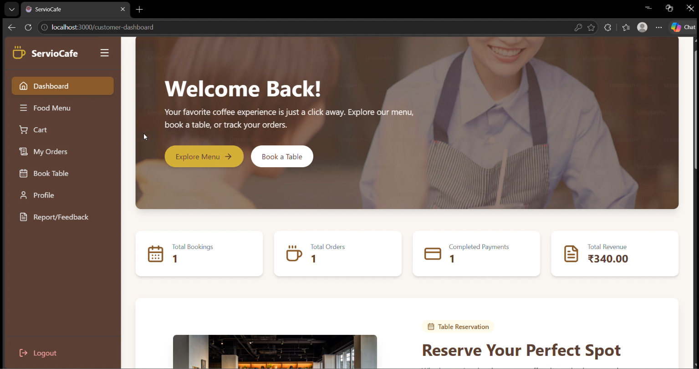
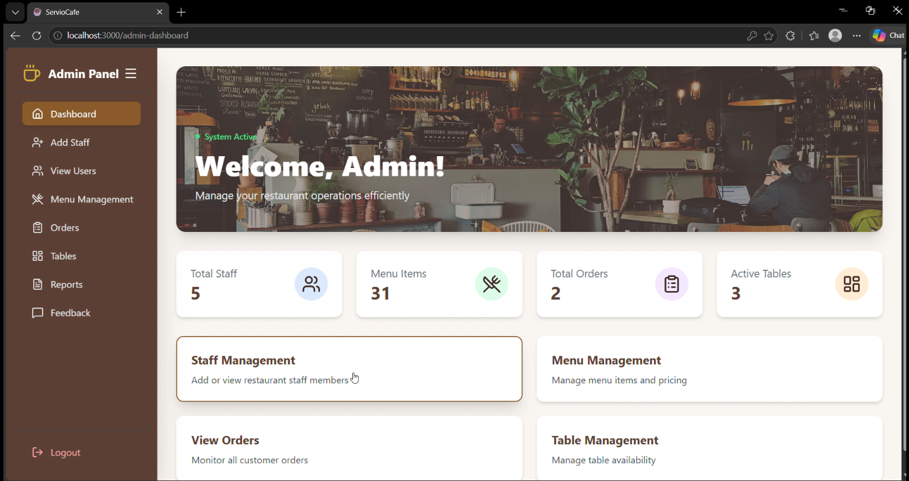
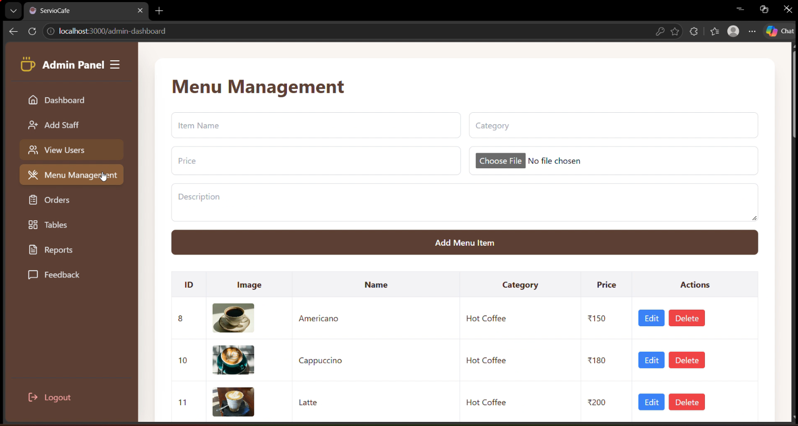
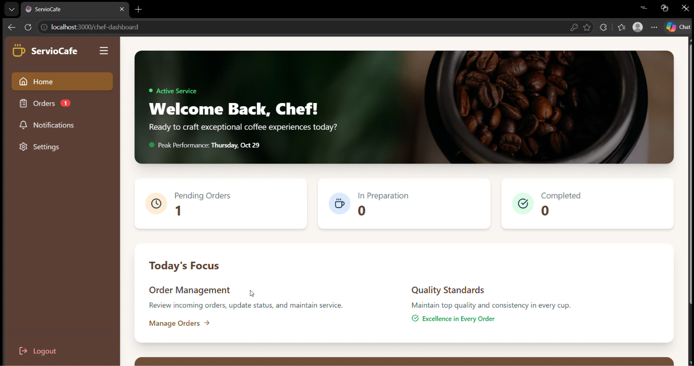
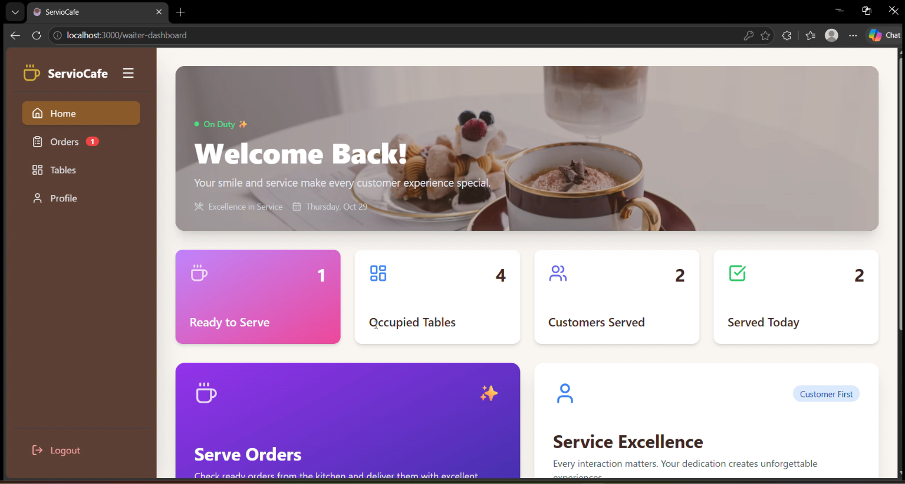
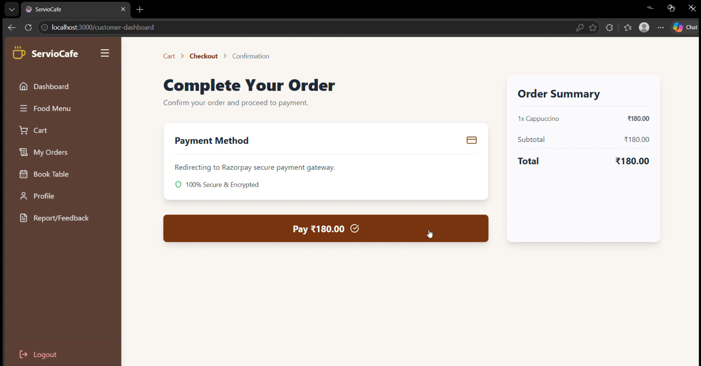
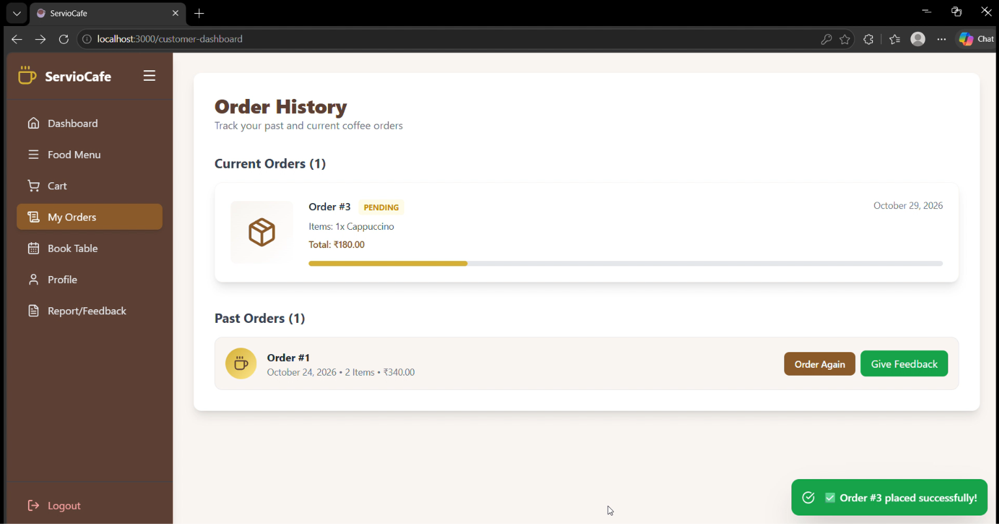

# ☕ ServioCafe — Coffee Shop Management System

A full-stack coffee shop management application built with **React.js, Django REST Framework, and PostgreSQL**. ServioCafe simplifies cafe operations through menu management, table reservations, order tracking, role-based dashboards, Razorpay test payments, and an AI-powered chatbot.

## 📌 Overview

ServioCafe provides a centralized platform for customers and cafe staff to manage the coffee shop workflow, from browsing the menu and booking tables to placing orders and tracking their progress.

The application includes dedicated dashboards for customers, administrators, chefs, and waiters, helping each role manage its tasks efficiently.

## 🖥️ Application Screenshots

The following screenshots showcase the application's interface and key workflows.

### 1. Customer Dashboard

Browse menu items, explore the available offerings, and access customer features.



### 2. Admin Dashboard

Manage menu items, monitor orders, and access reports and analytics.



### 3. Menu Management

Add, update, delete, and manage menu items with their prices, categories, and images.



### 4. Chef Dashboard

View incoming orders and update their preparation status.



### 5. Waiter Dashboard

Monitor orders and manage their progress through the cafe workflow.



### 6. Checkout and Orders

View the checkout workflow and place orders using the integrated payment flow.




## ✨ Features

### 👤 User Management
- User registration and login.
- Role-based access for customers, administrators, chefs, and waiters.
- Dedicated dashboards based on user roles.

### ☕ Menu Management
- Browse available menu items.
- Add, update, and delete menu items.
- Upload and display menu images.
- Manage item names, prices, categories, and details.

### 🪑 Table Reservations
- Book cafe tables.
- Select reservation dates and time slots.
- Manage table booking information.

### 🛒 Order Management
- Add menu items to the cart.
- Proceed through the checkout workflow.
- Place and track orders.
- View order history and current order status.
- Update order status through staff dashboards.

### 💳 Payment Integration
- Razorpay payment gateway integration.
- Create payment orders through the backend.
- Support for Razorpay test-mode transactions.

**Note:** Production payments require live credentials and appropriate server-side payment verification.

### 📊 Role-Based Dashboards
- **Customer:** Browse menus, reserve tables, place orders, and view order history.
- **Admin:** Manage menu items, monitor orders, and access reports and analytics.
- **Chef:** View incoming orders and update preparation status.
- **Waiter:** Monitor orders and manage order progress.

### 🤖 AI-Powered Chatbot
- Google Gemini API integration for AI-assisted customer interactions.
- Backend API endpoint for chatbot requests.

### 📧 Email Integration
- SMTP-based email functionality for supported application workflows, including order-related notifications.

## 🛠️ Tech Stack

| Component | Technology |
|---|---|
| Frontend | React.js, JavaScript, HTML5, CSS3 |
| Backend | Python, Django, Django REST Framework |
| Database | PostgreSQL |
| API Communication | REST APIs, JSON |
| Payment Gateway | Razorpay |
| AI Chatbot | Google Gemini API |
| Email Service | SMTP / Gmail SMTP |
| Image Handling | Django media uploads |
| API Testing | Postman |
| Version Control | Git and GitHub |

## 🏗️ Project Structure

```text
ServioCafe/
├── frontend/
│   ├── public/
│   ├── src/
│   └── package.json
├── backend/
│   ├── manage.py
│   ├── config/
│   ├── menu/
│   ├── orders/
│   ├── chat/
│        .
│        .
│        .
│        .   
│   
│   └── requirements.txt
├── screenshots/
│   ├── customer-dashboard.png
│   ├── admin-dashboard.png
│   ├── menu-management.png
│   ├── chef-dashboard.png
│   ├── waiter-dashboard.png
│   └── checkout.png
├── .gitignore
└── README.md
```

## ⚙️ Getting Started

### Prerequisites

Install the following:

- Python and a version compatible with your backend dependencies.
- Node.js and npm.
- PostgreSQL.
- Git.
- A Google Gemini API key for chatbot functionality.
- Razorpay test API credentials for payment testing.

### 1. Clone the Repository

```bash
git clone https://github.com/mahendra-samant/serviocafe-full-stack.git
cd serviocafe-full-stack
```

### 2. Set Up the Backend

Navigate to the backend directory:

```bash
cd backend
```

Create a Python virtual environment:

```powershell
python -m venv venv
.\venv\Scripts\Activate.ps1
```

Install dependencies:

```bash
pip install -r requirements.txt
```


### 3. Configure Environment Variables

Create a `.env` file in the backend directory and add the variables required by your Django configuration.

Example:

```env
DJANGO_SECRET_KEY=replace_with_a_secure_secret
DEBUG=True
ALLOWED_HOSTS=localhost,127.0.0.1

DB_NAME=serviocafe_db
DB_USER=your_postgres_username
DB_PASSWORD=your_postgres_password
DB_HOST=localhost
DB_PORT=5432

GEMINI_API_KEY=your_gemini_api_key

RAZORPAY_KEY_ID=your_razorpay_test_key_id
RAZORPAY_KEY_SECRET=your_razorpay_test_key_secret

EMAIL_HOST=smtp.gmail.com
EMAIL_PORT=587
EMAIL_HOST_USER=your_email_address
EMAIL_HOST_PASSWORD=your_email_app_password
```

### 4. Configure PostgreSQL

Create a PostgreSQL database, for example:

```sql
CREATE DATABASE coffee_platform_db;
```

Configure the database connection in your Django settings or environment variables.

### 5. Apply Database Migrations

From the backend directory:

```bash
python manage.py makemigrations
python manage.py migrate
```

Create an administrator account:

```bash
python manage.py createsuperuser
```

### 6. Start the Backend

```bash
python manage.py runserver 8080
```

Backend address:

`http://127.0.0.1:8080/`

Django administration:

`http://127.0.0.1:8080/admin/`

### 7. Set Up and Start the Frontend

Open another terminal and navigate to the frontend directory from the repository root:

```bash
cd frontend
npm install
```

Configure the frontend API base URL to point to your Django backend. Use the environment-variable naming convention supported by your project, such as `VITE_` for Vite or `REACT_APP_` for Create React App.

Local backend URL:

`http://localhost:8080`

Start the frontend using the command supported by your project:

```bash
npm start
```

For Vite projects, use:

```bash
npm run dev
```

Open the local URL displayed in the terminal.

## 🔌 API Overview

The application exposes REST APIs for communication between the React frontend and Django backend.

| Endpoint | Purpose |
|---|---|
| `/api/menu/add` | Add a menu item |
| `/api/orders` | Create or retrieve orders, depending on the HTTP method |
| `/api/payment/create-order` | Create a payment order |
| `/admin/` | Django administration interface |

Other endpoints may support menu updates, deletions, user management, table reservations, chatbot requests, and order status changes. Refer to the backend source code for the complete API list and supported request methods.

## 🔒 Security Considerations

- Store secrets in environment variables.
- Never commit `.env` files or API credentials.
- Use Django's secure password-handling mechanisms.
- Configure appropriate CORS origins and allowed hosts.
- Validate incoming data on the backend.
- Verify payment signatures and transaction status on the server.
- Use `DEBUG=False`, HTTPS, and secure production settings when deploying.
- Configure persistent storage for uploaded menu images in production.

## 🚀 Future Enhancements

- Deploy the frontend, backend, and PostgreSQL database.
- Add automated API and business-logic tests.
- Expand sales and order analytics.
- Add inventory tracking and low-stock alerts.
- Improve automated invoice and email notifications.
- Implement production-ready media storage, monitoring, and logging.

## 🎯 Learning Outcomes

This project demonstrates practical experience with:

- Full-stack application development.
- REST API development using Django REST Framework.
- PostgreSQL database integration.
- React and Python backend integration.
- File uploads and media handling.
- Third-party payment and AI API integration.
- Role-based workflows and dashboards.
- Git and GitHub version control.

## 👨‍💻 Author

**Mahendra Samant**

Computer Engineering | Python Development | Data Analytics

- GitHub:`https://github.com/mahendra-samant`

## 📄 License

This project is intended for learning and portfolio demonstration.
---

⭐ If you find this project interesting, consider starring the repository.
